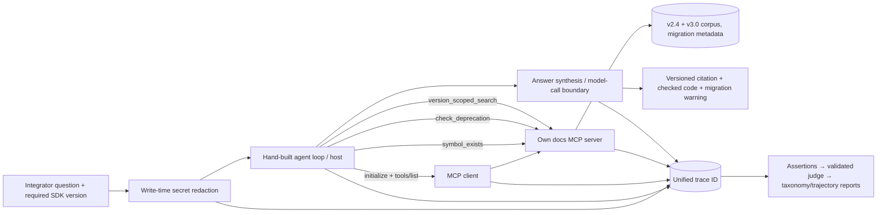

# SDK Docs Answer Engine — one-page architecture

The model-call boundary is answer synthesis in the host; MCP `initialize`, `tools/list`, and `tools/call` are local protocol operations and contain no model. Token cost is attributed to version resolution, discovery, symbol check, deprecation lookup, retrieval, and generation spans. One `trace_id` is required at every tool boundary.
